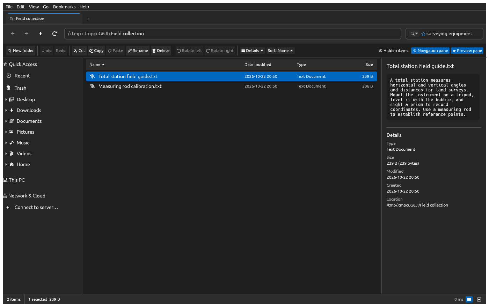

# Ninimma File Manager


A modern desktop file manager built in Rust with egui: large thumbnails, tabs,
file previews, undo, network folders, and optional private smart search.

**[Latest release and installers](https://github.com/tomblanchard312/Ninimma-FileManager/releases/latest)** ·
[All releases](https://github.com/tomblanchard312/Ninimma-FileManager/releases)

Ninimma is named after a Mesopotamian scribal goddess. An ancient hymn says:

> “The surveyor's gleaming line and the measuring rod suit you perfectly.
> You can hold your head high among the great princes.”

— [A hymn to Ninimma, Oxford Electronic Text Corpus of Sumerian Literature](https://etcsl.orinst.ox.ac.uk/cgi-bin/etcsl.cgi?text=t.4.21.1)



*Real Ninimma interface rendered by the UI test harness, searching a made-up
collection for “surveying equipment”. Smart mode uses the local BGE model to find
related documents about total stations and measuring rods. The demo uses an isolated index with an in-memory key store;
normal installations use the system keyring or a passphrase. No personal files
appear in this image.*

## Install

Open the [latest release](https://github.com/tomblanchard312/Ninimma-FileManager/releases/latest)
and choose the package for your system. Assets appear only after the corresponding
build and packaging checks pass; an absent asset is not a supported download yet.

| System | Package | Installation |
|---|---|---|
| Ubuntu, Debian, Linux Mint, Zorin | `.deb` | Open with your software installer and choose Install. |
| Fedora, openSUSE | `.rpm` | Open with your software installer and choose Install. |
| Windows 10/11 x64 | `ninimma-windows-x64-setup.exe` | Run the per-user installer; no administrator account required. |
| macOS Apple Silicon | `ninimma-macos-arm64.dmg` | Open and drag Ninimma to Applications. |
| macOS Intel | `ninimma-macos-x64.dmg` | Open and drag Ninimma to Applications. |
| FreeBSD 14/15 amd64 | Matching `.pkg` | Install with `pkg add` as an administrator. |
| Linux portable/per-user | `ninimma-linux-x64.tar.gz` | Extract, then run `./install.sh`. |

Linux packages require glibc 2.35 or newer. A software installer such as GNOME
Software or Discover must be configured to open local packages. Otherwise use
`sudo apt install ./ninimma*.deb` or `sudo dnf install ./ninimma*.rpm`.

Installation adds Ninimma to the application menu with its icon. Open it from
there, then right-click its taskbar/dock icon and choose your desktop's **Pin**,
**Add to Favorites**, or equivalent. Pinning remains your choice.

Windows packages are unsigned; macOS packages are unsigned and not notarized.
Their operating systems may require additional approval to open downloaded apps.
The Linux installer may request native authentication; the file manager itself
runs as your ordinary account. Checksums are supplied with releases for integrity,
not as a substitute for a publisher signature.

### Optional default file manager (Linux)

After installing a native package or the tarball, open **Help → About Ninimma**
and choose **Make default file manager**. **Restore previous default** restores
the folder application saved when you enabled Ninimma. Both affect only your user
account; installing Ninimma does not change defaults automatically.

The same actions are available from the desktop launcher's context menu or as:

```sh
ninimma --make-default
ninimma --restore-default
```

This selects the handler for `inode/directory`. Some desktops' keyboard shortcuts,
desktop icons, and browser “Show in folder” actions use separate settings or an
already-running FileManager1 service. This does not uninstall the original file
manager, replace the desktop shell, or change Windows Explorer/Finder defaults.

### Flatpak (experimental)

The repository includes a Flatpak manifest and a separate **Flatpak** workflow.
When a bundle has built successfully, it is attached to the selected release as
`ninimma-linux-x64.flatpak`. Open that bundle with your software installer, or use
`flatpak install --user ./ninimma-linux-x64.flatpak`. There is no Flathub listing yet.

A file manager needs broad access to your files; this Flatpak requests host-file
access and network access. The runtime's `/usr`, `/etc`, and libraries differ from
the host's. Host terminal, disk-management and application-launch integrations
remain experimental. Choose the native package for complete host integration.
Use your desktop's **Default Applications** settings to select the Flatpak edition.

### Optional Linux helpers

FFmpeg supplies video thumbnails and frames; Poppler (`pdftotext`, `pdftoppm`)
supplies PDF text/previews. ImageMagick can add image-format support. Network
connections may need GVfs backends; KDE mounts may need `kio-fuse`. Cloud accounts
can be mounted with rclone. Ninimma does not bundle cloud credentials or sign you
into providers automatically.

## Features

### Views and thumbnails
- **Ctrl + mouse wheel resizes icons** smoothly from 32 px up to 256 px. Keep scrolling down to go to Tiles, then Details, just like Explorer. A trackpad pinch works too. Ctrl + `+`/`-` and the slider in the status bar do the same.
- **View presets** Extra large / Large / Medium / Small icons, Tiles, Details (`Ctrl+Shift+1…6`)
- **Per-folder views**: each folder remembers its own view, icon size and sort order. Folders that are mostly pictures open in large icons automatically.
- **Thumbnails** for photos (JPEG, PNG, GIF, BMP, WebP, TIFF, AVIF, …), videos (via ffmpeg), PDFs and HEIC. **EXIF orientation is respected**, so phone photos aren't shown sideways.
- Thumbnails load in the background, on-screen items first, and are cached on disk.
- **Natural sorting** like Explorer: `IMG_2` comes before `IMG_10`
- **Auto-refresh** when files change on disk
- **Themes** (View → Theme): light, dark, high contrast dark and light, or following the system's light/dark setting (the default). **Interface size** (View → Interface Size) scales the whole window from 80% to 200%. Both switch at once and are remembered. Native Windows accent colors/system icons and GNOME/KDE widget/icon themes are not yet integrated. Icons are [Lucide](https://lucide.dev)'s (ISC), drawn in the theme's colours.

### Selection
- Click, **Ctrl+click** (toggle), **Shift+click** (range), **Ctrl+A**
- **Rubber-band selection**: drag on empty space (hold Ctrl to add to the selection)
- Arrow keys, Home/End, Page Up/Down, with Shift to extend
- **Type-ahead**: type a name to jump to it

### Pictures
- **Bulk rotate**: select any number of pictures and press **Rotate left / Rotate right** in the toolbar or the right-click menu
  - JPEGs are rotated **losslessly and instantly** by updating the EXIF orientation tag, the same approach Windows uses, so the photo is never recompressed.
  - PNG, BMP, TIFF, WebP, TGA and QOI are rotated and re-saved losslessly.
  - Files are written atomically, so a crash or full disk can never leave a half-written photo.

### File management
- Cut / Copy / Paste (`Ctrl+X/C/V`). Copies into the same folder become `photo - Copy.jpg`. When names clash elsewhere you choose **Replace**, **Skip** or **Keep both**, as in Explorer. Replaced files go to the trash, and folders merge.
- **Undo / Redo** (`Ctrl+Z` / `Ctrl+Y`) for rename, move, copy, delete-to-trash, new folder and rotate. Undoing a delete restores the item from the trash.
- Paste files copied in Nautilus, Nemo, Dolphin or a terminal (paths or `file://` URIs on the clipboard)
- **Delete moves to Trash / Recycle Bin**. `Shift+Delete` deletes permanently after confirmation.
- Rename (`F2`). The name is pre-selected without its extension. With several items selected, they are numbered: `Holiday (1).jpg`, `Holiday (2).jpg`, …
- New folder (`Ctrl+Shift+N`), Copy as path (`Ctrl+Shift+C`)
- **Drag and drop** to and from other apps (Nemo, Nautilus, browsers, the desktop) and between folders. As in Explorer, dropping on the same drive moves and onto another drive copies; Ctrl forces a copy and Shift forces a move. Linux X11, Windows and macOS are supported; Wayland isn't yet.
- Long-running operations run in the background with progress in the status bar

### Menus, new documents and bookmarks
- A **File / Edit / View / Go / Bookmarks / Help** menu bar, like Nemo
- **New Document ▸** (File menu and right-click) creates an empty file, a text document, or a copy of anything in your **Templates** folder (subfolders become submenus), then lets you name it straight away. Ctrl+Z undoes it.
- **Bookmarks** (`Ctrl+D`) appear in the sidebar and the Bookmarks menu. On Linux they're GTK bookmarks, so they're **shared with Nemo, Nautilus and file dialogs**.
- **Open in Terminal** from the File menu or right-click

### VHD/VHDX and BitLocker (Windows and Linux)
- Open **File → Disk images & BitLocker…**, or right-click a `.vhd` / `.vhdx` file to mount or unmount it. Enter the full image path. **Read-only** is selected initially; clear it to mount **read/write**. Unmount and mount again to change access mode. Close any VM using the image first.
- On **Windows**, mounting uses the native Storage commands. After mounting an encrypted image, choose **Unlock BitLocker** and enter its drive letter (such as `E:`). Right-clicking a drive in **This PC** also offers unlock and lock. Choose password or 48-digit recovery password; Windows asks for the secret in an elevated PowerShell console.
- On **Linux**, install `sudo`, Python 3, QEMU tools (`qemu-utils` on Debian/Ubuntu), `cryptsetup`, `util-linux`, a supported terminal, and the filesystem driver (`ntfs-3g` for NTFS). Mounting attaches the image to a free NBD device, asks which partition to browse, and prompts for a BitLocker password or recovery password when needed. A physical BitLocker partition can also be unlocked by entering its device path, such as `/dev/sdb1`.
- Linux mounts appear under `/mnt/ninimma-…` in **This PC**. Read/write mode enables writes at the image, decrypted mapping and filesystem layers. **Unmount VHD/VHDX** (image path) or **Lock / unmount BitLocker** (original physical partition path) removes mounts created by this feature. Busy mounts are left attached so you can close files and retry. Mounts remain available after closing the app; explicitly unmount them when finished.
- Administrator and unlock prompts, progress and errors appear in the OS terminal. The app opens that terminal asynchronously and refreshes drives every few seconds; it does not store unlock secrets. Windows needs its Storage/BitLocker PowerShell commands; Linux needs a kernel with NBD and dm-crypt support. MacOS and FreeBSD do not expose these actions.

### Network shares and cloud storage
- A **Network & Cloud** sidebar section lists:
  - shares connected in GNOME/Nemo (SMB, SFTP, FTP, WebDAV, AFP)
  - system-mounted SMB/NFS/sshfs shares
  - rclone and onedriver cloud mounts
  - sync folders (Dropbox, OneDrive, …)
  - phones connected over USB

  Right-click a share you connected to disconnect it.
- Type **`smb://server/share`**, **`sftp://user@host/dir`** or **`\\server\share`** in the address bar, or use **Connect to Server…**. A user name and password are asked for only when the server needs them, and passwords are never saved.
- Folders load in the background, so a slow share or cloud folder shows "Loading…" instead of freezing the window
- In cloud folders that stream files on demand, thumbnails are off by default, because each one would download the whole file. One click in the status bar turns them on.
- For Google Drive, OneDrive (including Business/SharePoint) and Dropbox on Linux, [rclone](https://rclone.org) mounts each account as a normal folder that shows up here. (GNOME Online Accounts' Google Drive shows folders by internal IDs to apps other than GNOME's own.)

### Search and indexing (optional)
- The search box filters the folder on screen as you type, with no index needed. Its **🔍⏷** menu switches to **This folder and subfolders** or **All indexed locations**, which search an index instead.
- Indexing is **off until you turn it on** in **Edit → Search Indexing…**. It suggests your Documents, Desktop, Pictures, Music, Videos and Downloads folders, and you can add or remove folders and exclusions. It never indexes whole drives on its own.
- Write searches naturally: **"receipts from Arizona trip in December"** finds receipts whose text mentions Arizona (or AZ) and photos taken in Arizona, dated in December. Filler words are ignored, dates like "December", "last month" or "in 2024" become date filters, and words like "photos" narrow the type.
- With **Full text** on (the default), the index also reads the words inside documents (text, Word, PowerPoint, spreadsheets, and PDFs when `pdftotext` is installed) and when and where photos were taken (from EXIF, with GPS turned into a town and state offline). With **Basic**, it indexes names only.
- Filters can narrow results: `ext:pdf,docx`, `type:image` (or video, audio, document, archive, code, folder), `size:>10MB`, `modified:week` (or today, month, year, `>2026-01-31`) and `path:photos`. Names containing every word come first, then files matching the most words in their text, folders or photo place. Tooltips show what matched, with a short excerpt.
- **Private and encrypted.** The index is kept per user in a private folder: `~/.local/state/ninimma/index` on Linux and FreeBSD, `%LOCALAPPDATA%\Ninimma\Index` on Windows, `~/Library/Application Support/Ninimma/Index` on macOS. It is encrypted with SQLCipher using a random key. The key is stored in the system keyring (Credential Manager, Keychain, or GNOME Keyring/KWallet), which your login unlocks. Without a keyring, you choose a passphrase once per session instead. Nothing is sent anywhere, and search history isn't kept.
- **Light on resources.** One background thread at low priority. It pauses on battery (optional), while you copy files, when the computer is busy or disk space is low, and whenever you click **Pause**. Files you add, change or delete are picked up within a second or so. Otherwise it sleeps.
- **What it skips:** version-control, build, cache, browser-profile and credential folders (`.git`, `node_modules`, `.ssh`, keyrings …), system and temp folders, hidden files, links, disk images, encrypted containers, cloud placeholders that would download, other drives mounted inside a folder, and network shares unless you allow each one.
- **Delete index and key** removes the index and its key and never touches your files.
- **Smart** mode adds matches by meaning ("receipts" also finds invoices) using a small open model (BGE small, 37 MB, MIT), run on your computer by built-in llama.cpp. The model is downloaded only when you ask, checked against its published checksum, and can be copied in by hand on computers without internet. Its vectors are encrypted like the rest of the index.
- **Read text in photos (OCR)**, off by default: photographed receipts, letters and scanned PDFs become searchable by what's printed on them. It uses IBM's granite-docling model (Apache-2.0, 282 MB, downloaded on request) through the same built-in llama.cpp. Only images that look like paper are read, in the background, using about 500 MB of memory while it runs.
- **Search what's in photos and videos** (with Smart): "photos of mountains" or "video of a cat" find them by what they show, with no such words in their names. It uses OpenAI's CLIP model (MIT, 605 MB, downloaded on request), run in pure Rust with candle. Each photo, and three frames of each video (with FFmpeg), is looked at once in the background. Only numbers are stored, encrypted with the rest of the index.
- **Understand sentences** (experimental, off by default): a small local model (Qwen2.5 0.5B, Apache-2.0, 469 MB, downloaded on request) picks the words that matter most in a search written as a sentence, and files matching them move up. Results appear immediately from the built-in rules and are re-ranked after local inference finishes. The model never decides dates, places or types, and never adds or hides results.

### Desktop support
- Works on any Linux desktop (GNOME, KDE Plasma, Cinnamon, XFCE, …), FreeBSD, Windows and macOS. It doesn't depend on GNOME.
- **KDE:**
  - Dolphin's Places appear under Bookmarks.
  - Shares you open in Dolphin appear under Network & Cloud when `kio-fuse` is installed.
  - Connect to Server needs the `gvfs-backends` package.
- **Bookmarks** you add here are stored in GTK's bookmarks file (shared with Nemo and Nautilus) on Linux, and in the app's settings on Windows and macOS.
- Dragging files out to other apps works on X11, Windows and macOS, but not yet on Wayland.

### Navigation
- **Expandable folder tree**, Quick Access, This PC, and Recent Files and Folders.
- **Bulk rename** with find/replace, regular expressions, numbering, case changes and saved presets.
- **ZIP compression and extraction**, file/folder properties, and supported permission controls.
- **Tabs**: `Ctrl+T` opens a tab, `Ctrl+W` closes it, and `Ctrl+Tab` switches. Middle-click a folder to open it in a background tab. Each tab keeps its own history, view and selection, and tabs are restored on the next launch. Drop files on a tab to move them into its folder.
- **Breadcrumb address bar**: click any folder in the path, or click the empty part of the bar (`Ctrl+L`) to type a path. `~` works.
- Back / Forward / Up, including the **mouse side buttons**
- Navigation pane with Quick Access (follows localized XDG folders on Linux) and drives with free-space bars
- Going up selects the folder you came from
- Opens where you left off, or in the folder passed on the command line

### Preview pane
- Large image/video preview, text and source files, Excel/ODS sheets, Word and PowerPoint text
- File details, plus total size for multi-selections

## Keyboard and mouse

| Action | Shortcut |
|---|---|
| Resize icons | **Ctrl + mouse wheel**, Ctrl + `+` / `-` |
| Extra large / Large / Medium / Small icons | `Ctrl+Shift+1` / `2` / `3` / `4` |
| Tiles / Details | `Ctrl+Shift+5` / `6` |
| Back / Forward | `Alt+←` / `Alt+→`, `Backspace`, mouse side buttons |
| Up | `Alt+↑` |
| Open | `Enter`, double-click |
| Open folder in new tab | middle-click |
| New tab / close tab | `Ctrl+T` / `Ctrl+W` |
| Next / previous tab | `Ctrl+Tab` / `Ctrl+Shift+Tab` |
| Undo / Redo | `Ctrl+Z` / `Ctrl+Y` |
| Invert selection | `Ctrl+Shift+I` |
| Bookmark this folder | `Ctrl+D` |
| Home folder | `Alt+Home` |
| Keyboard shortcuts | `F1` |
| Quit | `Ctrl+Q` |
| Select all / clear | `Ctrl+A` / `Esc` |
| Cut / Copy / Paste | `Ctrl+X` / `Ctrl+C` / `Ctrl+V` |
| Copy as path | `Ctrl+Shift+C` |
| Rename | `F2` |
| Move to trash / delete permanently | `Delete` / `Shift+Delete` |
| New folder | `Ctrl+Shift+N` |
| Edit address | `Ctrl+L`, `Alt+D`, `F4` |
| Search | `Ctrl+F`, `F3` |
| Refresh | `F5`, `Ctrl+R` |
| Show hidden files | `Ctrl+H` |

File shortcuts are ignored while you're typing in the address or search box, so `Delete` and `Backspace` there only edit text.

## Limits and privacy

- Dragging files out to other apps is not yet supported on Wayland.
- Trash restoration is supported on Linux and Windows; macOS undo of deletion
  remains limited. Permanent deletion cannot be undone.
- Optional model downloads occur only when requested. Processing is local, but
  downloading a model contacts its configured model host.
- The encrypted index protects data at rest; it does not protect against malware
  running as your account while the index is unlocked. Never index information
  your account should not access.
- Disk images and BitLocker need platform tools and explicit native authentication.
  Those operations require separate disposable-system validation; a successful
  build does not establish safe handling of every encrypted disk format.
- Ninimma uses its own settings, thumbnail cache, model directory and index-key
  service. Existing FileExplorer settings and encrypted indexes are not migrated.

## Build and release

Install Rust stable, a C/C++ toolchain, CMake, libclang, and OpenSSL development
headers (plus the platform window-system development libraries on Linux).

```sh
cargo build --locked --release
cargo fmt --all -- --check
cargo test --locked
cargo clippy --locked --all-targets -- -D warnings
```

Smart search is included by default. `--no-default-features` builds without local
AI inference. GPU acceleration is optional with `gpu-vulkan` or `gpu-metal`.
Linux `.deb`/`.rpm` packaging uses `cargo-deb` and `cargo-generate-rpm`; the release
script builds inside Ubuntu 22.04 for compatibility. A version tag matching
Cargo.toml triggers the native installer workflow. Every required platform job
must pass before the release is published. Flatpak is built separately by choosing
an existing release tag in its workflow.

The screenshot is reproducible with a locally supplied, checksum-verified BGE
model; it does not download models or inspect personal folders:

```sh
NINIMMA_DEMO_MODEL=/absolute/path/to/bge-small-en-v1.5-q8_0.gguf \
  cargo test --locked --features readme-screenshot \
  readme_smart_search_surveying_equipment -- --ignored --nocapture
```

## Security checks

CI runs Rust tests and Clippy. CodeQL scans Rust, the Python disk helper, and
GitHub Actions workflows. Dependabot proposes Cargo and workflow updates;
`cargo-audit` checks Rust advisories weekly and when dependencies change.
Dependency review rejects new high-severity vulnerable dependencies in PRs.
These checks complement testing; they are not a guarantee that a release is safe.

## License and attribution

Copyright 2026 tomblanchard312. Ninimma is derived from
[FileExplorer](https://github.com/tomblanchard312/fileexplorer), with independent
branding, desktop integration and release packaging. This repository starts with
a fresh source snapshot; the original Git history is not imported.

Licensed under [Apache-2.0](LICENSE). Keep [NOTICE](NOTICE), the licence, and required
third-party attributions with redistributed copies. The embedded interface icons
use Lucide; its full licence is in [LICENSE-lucide](packaging/icons/LICENSE-lucide).
Modified source files are marked with Ninimma modification notices.

## Contribute and verify downloads

[Suggest an idea or report a bug](https://github.com/tomblanchard312/Ninimma-FileManager/issues/new/choose).
Contributors work through forks and reviewed pull requests. See the
[contribution policy](.github/CONTRIBUTING.md) and [security policy](.github/SECURITY.md).
Future releases built with the attestation-enabled workflows include GitHub build
provenance. Verify a downloaded installer with:

```sh
gh attestation verify DOWNLOAD -R tomblanchard312/Ninimma-FileManager
```

These attestations do not replace operating-system code signing.
